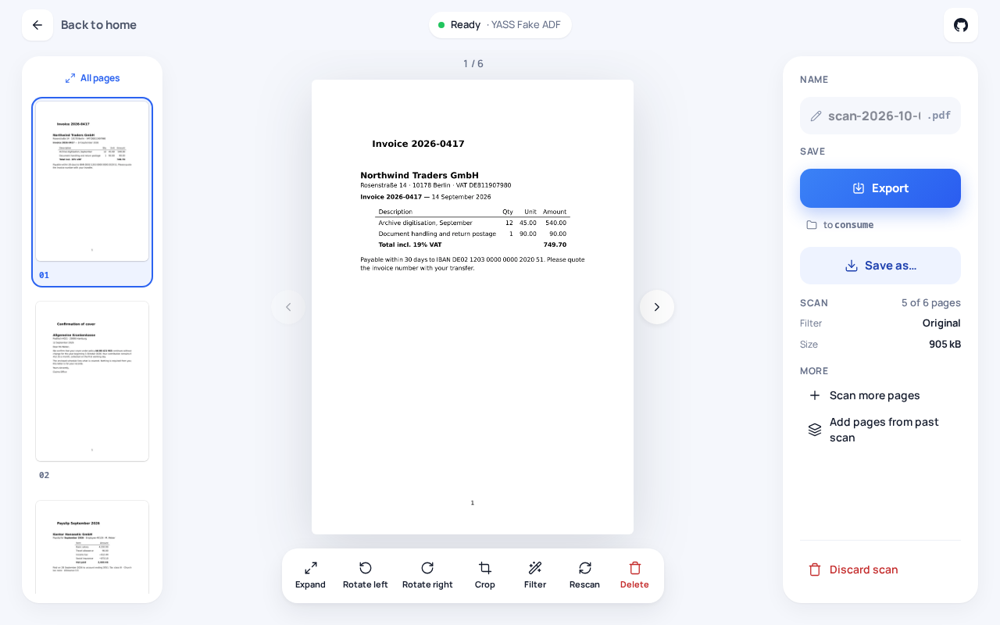
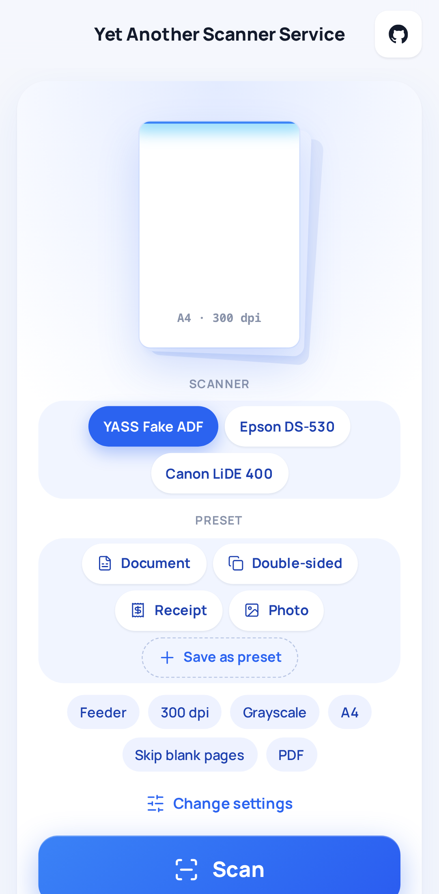
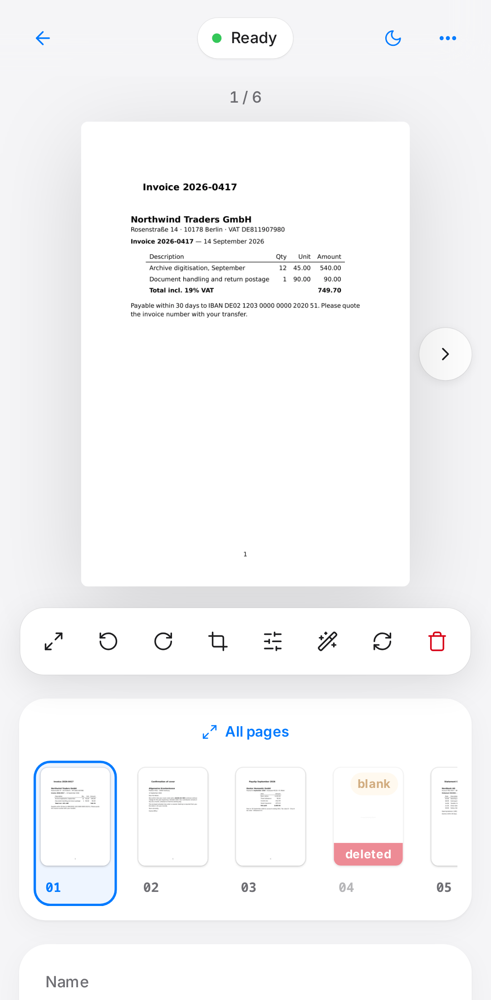
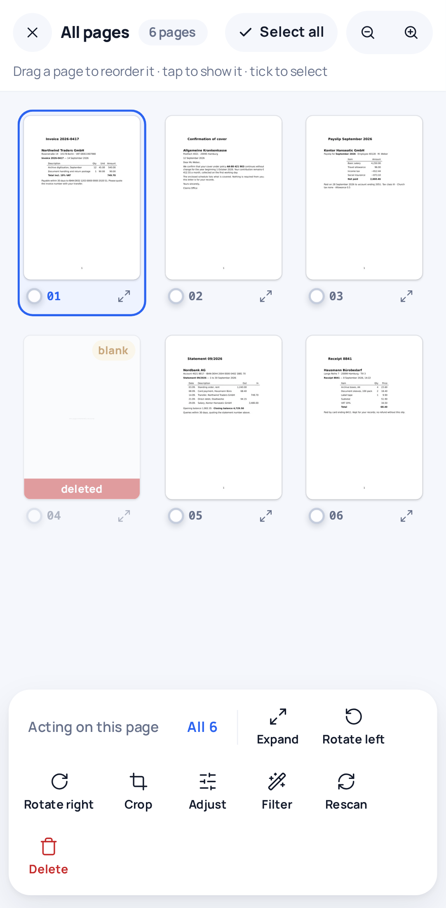
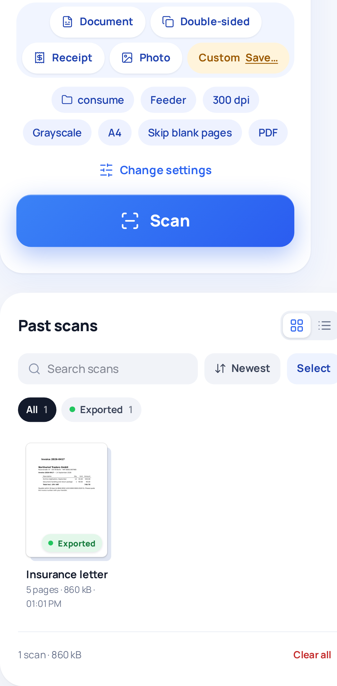

<div align="center">


# YASS

**Yet Another Slop Scanner**: scan, fix up the pages, save a PDF. *Yasss.*

A desktop app for **Linux, Windows and macOS** that can also run on another machine and be used from any browser on your network.

[Features](#features) · [What you need](#what-you-need) · [Desktop app](#desktop-app) · [Run it on another machine](#run-it-on-another-machine) · [Configuration](#configuration) · [Development](#development)

</div>

YASS is a scanning app for the scanner on your desk. Press **Scan**, let the feeder run empty,
rotate, crop and reorder the pages, and save the document. It runs as a native window on Linux,
Windows and macOS and opens no network port at all.

The fun part: the same app can also run on another machine, such as the home server your scanner is
plugged into, and every phone and laptop on your LAN gets the same screens in the browser. See
[Run it on another machine](#run-it-on-another-machine).

<p align="center">
  
</p>

<p align="center">
  
  
  
  
</p>

## Features

| | |
|---|---|
| **Linux, Windows and macOS** | A native desktop app on all three, with no server and no open port. |
| **Scan in one tap** | Live scanner status, presets, and pages that show up as they leave the feeder. |
| **Review before saving** | Rotate, crop, straighten, adjust brightness and contrast, apply filters (Enhance, Grayscale, B&W, Despeckle, Auto-levels), reorder by dragging, delete and restore. Edits are non-destructive. |
| **Blank pages handled** | Blank pages are detected and pre-marked deleted. |
| **Edit many at once** | *All pages* shows the whole scan on one screen; tick pages and edit them together. |
| **Save anywhere** | *Save as…* downloads a PDF, or one image per page, to the device you are holding. Optionally *Save to server* drops it into a fixed folder, such as a [paperless-ngx](https://docs.paperless-ngx.com/) consume folder. |
| **Also on your phone** | Run it on another machine and use it from any browser on your LAN: an installable PWA with swipe preview, full keyboard control and 44 px touch targets. |
| **One config file** | `yass.yaml`, with every key overridable from the environment. |
| **Try without hardware** | `--fake` simulates a scanner. |

Built with .NET 10 and [NAPS2.Sdk](https://www.naps2.com/sdk) for scanning, SvelteKit and
Tailwind for the UI, and SignalR over MessagePack in between. No database: scans are plain
directories.

## What you need

**A scanner** that one of these drivers can reach:

| Driver | Platforms | Scanners |
|---|---|---|
| SANE | Linux | USB and network scanners supported by [`sane-backends`](http://www.sane-project.org/sane-supported-devices.html) |
| WIA | Windows | Anything with a Windows scanner driver |
| eSCL (AirScan) | Linux, Windows, macOS | Most modern network scanners and multifunction printers, no driver needed |

No scanner at hand? `--fake` simulates one.

**For the desktop app:**

| Platform | Needs |
|---|---|
| Linux (x86-64) | WebKitGTK 4.1 (`webkit2gtk-4.1`), plus `sane-backends` for USB scanners |
| Windows (x64) | Windows 10 or 11, which already ship the WebView2 runtime |
| macOS (Apple Silicon) | A scanner that speaks eSCL; USB scanners only work if they do |

.NET is bundled, so nothing else has to be installed.

**For running it on another machine:** Docker, NixOS, or the .NET 10 SDK and Node 24 with pnpm to
build it yourself. Any current browser works as the client: Chrome, Edge, Firefox or Safari, on a
phone or a computer.

## Desktop app

For a scanner plugged into, or on the same network as, the computer you are sitting at. It shows
the app in a native window ([Photino](https://www.tryphotino.io/)). The UI talks to the scanning
code inside the same process, so it **opens no port, not even on localhost**.

Download it from the [releases](https://github.com/antonkesy/YASS/releases):

| Platform | File | Notes |
|---|---|---|
| Linux | `YASS-<version>-x86_64.AppImage` | Needs WebKitGTK 4.1 (`webkit2gtk-4.1`). |
| Windows | `YASS-<version>-windows-x64-setup.exe` | Per-user install, no admin prompt. Not signed, so SmartScreen warns once. |
| macOS (Apple Silicon) | `YASS-<version>-macos-arm64.zip` | Not notarised: allow it under *Privacy & Security*, or run `xattr -dr com.apple.quarantine /Applications/YASS.app`. |

Portable zips and `SHA256SUMS` are attached as well. With Nix:
`nix run github:antonkesy/YASS#desktop -- --fake`.

The desktop app reads the same `yass.yaml` from `~/.config/yass/` (Linux), `%APPDATA%\yass\`
(Windows) or `~/Library/Application Support/yass/` (macOS). The file is optional, and `server:` is
ignored. The scanner driver defaults to SANE on Linux, WIA on Windows and eSCL on macOS; on a Mac,
USB scanners work only if they speak eSCL ([why](SPEC.md#6-scanning-and-export-with-naps2)).

## Run it on another machine

YASS can also run as a small web server on the machine the scanner is attached to, such as a home
server. Every phone and laptop on your LAN then opens it in the browser and gets the same screens as the desktop app: scan from the couch, review on your phone, save the
PDF to the device you are holding or straight into a folder on the server, such as a
[paperless-ngx](https://docs.paperless-ngx.com/) consume folder.

> [!WARNING]
> **No authentication. LAN only.** Anyone who can reach the port can scan, view and delete
> documents. Bind YASS to a LAN address, keep it behind your firewall, and never expose it to
> the internet or a public reverse proxy.

### Try it

```sh
cd demo && docker compose up --build    # open http://localhost:8080
```

A throwaway setup with a simulated scanner. Saved PDFs land in `demo/output/`
([details](demo/README.md)).

### Docker Compose

```yaml
services:
  yass:
    build: .                          # no prebuilt image is published
    restart: unless-stopped
    ports:
      - "192.168.1.10:8080:8080"      # your host's LAN address
    volumes:
      - ./yass.yaml:/etc/yass/yass.yaml:ro
      - yass-sessions:/data/sessions
    devices:
      - /dev/bus/usb:/dev/bus/usb     # USB scanners
volumes:
  yass-sessions:
```

Copy [`yass.example.yaml`](yass.example.yaml) to `yass.yaml`, then run `docker compose up -d`.
[`docker-compose.example.yml`](docker-compose.example.yml) has the commented version; eSCL
scanners need `network_mode: host` for mDNS discovery.

### NixOS

```nix
{
  inputs.yass.url = "github:antonkesy/YASS";

  imports = [ inputs.yass.nixosModules.default ];
  hardware.sane.enable = true;
  services.yass = {
    enable = true;
    settings = {
      server.listen = "192.168.1.10:8080";
      scanner.device = "epsonds";
    };
  };
}
```

Or try it with `nix run github:antonkesy/YASS -- --fake`.

### From source

```sh
nix develop
pnpm --dir web install && pnpm --dir web build
YASS_WEBROOT=$PWD/web/build dotnet run --project src/Yass.Server -- --fake
```

## Configuration

One YAML file (`--config PATH` or `YASS_CONFIG`; a missing file means defaults). Override any key
with `YASS__section__key`, e.g. `YASS__sessions__directory=/mnt/yass`. Invalid values stop startup
and name the bad key. Everything except `server` reloads at runtime.

<details>
<summary><b>All keys</b></summary>

| Key | Default | Meaning |
|---|---|---|
| `server.listen` | `0.0.0.0:8080` | Bind address. **No auth: use a LAN address.** |
| `server.base_path` | `/` | Path prefix when served under a sub-path. |
| `scanner.driver` | `auto` | `auto`, `sane`, `escl` or `wia`. |
| `scanner.device` | `""` | Device id or a substring of id/name; empty = first found. |
| `scanner.poll_interval_seconds` | `5` | How often scanner readiness is checked. |
| `scanner.defaults.source` | `feeder` | `flatbed`, `feeder` or `duplex`. |
| `scanner.defaults.dpi` | `300` | 50–1200. |
| `scanner.defaults.color` | `grayscale` | `bw`, `grayscale` or `color`. |
| `scanner.defaults.page_size` | `a4` | `a4`, `a5`, `letter`, `legal`. |
| `scanner.defaults.brightness` / `contrast` | `0` | −100..100. |
| `scanner.defaults.blank_page_detection` | `true` | Skip (real scanner) or pre-mark (fake) blank pages. |
| `scanner.defaults.blank_page_threshold` | `0.02` | 0..1. |
| `scanner.defaults.auto_deskew` | `false` | Straighten pages while scanning. |
| `scanner.defaults.device` | `""` | Default scanner by exact id. |
| `output.directory` | `""` | Server folder for *Save to server*; empty turns it off. |
| `output.pdf.compression` | `jpeg` | `jpeg` or `lossless`. |
| `output.pdf.jpeg_quality` | `75` | 1–100. |
| `processing.max_concurrent_renders` | `2` | Upper bound on decoded bitmaps in memory. |
| `processing.thumbnail_width` | `320` | px |
| `processing.preview_max_width` | `1600` | px |
| `sessions.directory` | `/data/sessions` | One directory per scan. |
| `sessions.retention_hours` | `24` | Older scans are deleted; `0` keeps them. |
| `logging.level` | `info` | `trace` … `critical`. |
| `logging.format` | `text` | `text` or `json`. |

The scan settings in `scanner.defaults` are only defaults: every one of them can be changed in the
UI and is remembered per browser.

</details>

### Scanner setup

- **USB (SANE):** install `sane-backends` and make the device readable by the service user (the
  `scanner`/`lp` group, or udev rules). Check it with `scanimage -L`.
- **Network (eSCL / AirScan):** set `scanner.driver: escl`. Most modern network scanners work
  without a driver.
- Webcams and other cameras are never listed as scanners.

## Development

```sh
nix develop && pre-commit install
dotnet test                    # backend
pnpm --dir web test            # unit tests
pnpm --dir web test:e2e        # Playwright smoke tests against --fake
pnpm --dir web hub:generate    # TS hub client from the C# contract
pnpm --dir web screenshots     # refresh the images above
```

[SPEC.md](SPEC.md) holds the design and the reasons behind it.
Commits follow Conventional Commits, and release-please cuts releases.

| Path | What |
|---|---|
| `src/Yass.Core` | Domain, config, hub contract |
| `src/Yass.Scanning` | NAPS2 adapter |
| `src/Yass.Export` | PDF and image output, file name templates |
| `src/Yass.App` | Sessions, scan loop, rendering, export: everything both hosts share |
| `src/Yass.Server` | Web host: SignalR hub, image endpoints |
| `src/Yass.Desktop` | Desktop host: Photino window, `yass://` scheme, message bridge |
| `src/Yass.Fake` | Simulated scanner |
| `web/` | SvelteKit PWA, one build for both hosts |
| `nix/` | Packages and the NixOS module |

## License

[MIT](LICENSE)
